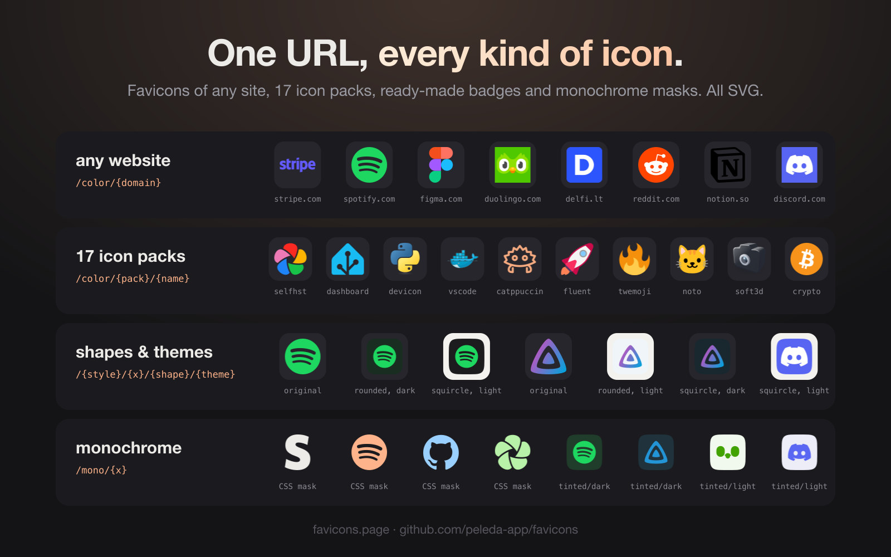
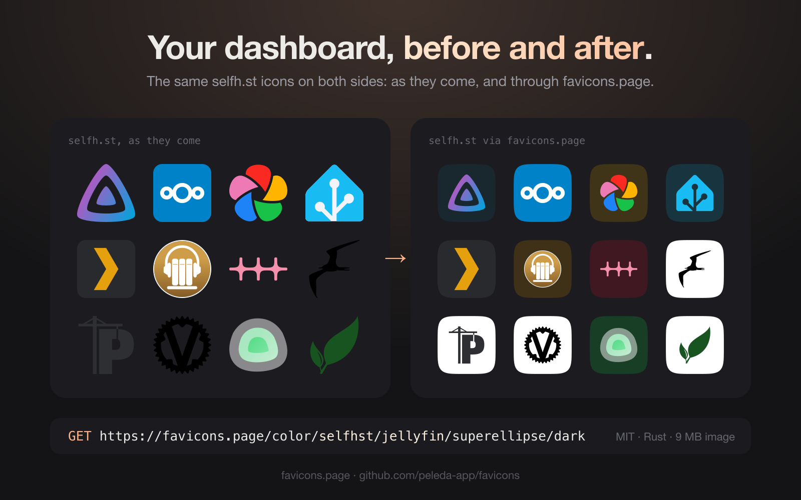
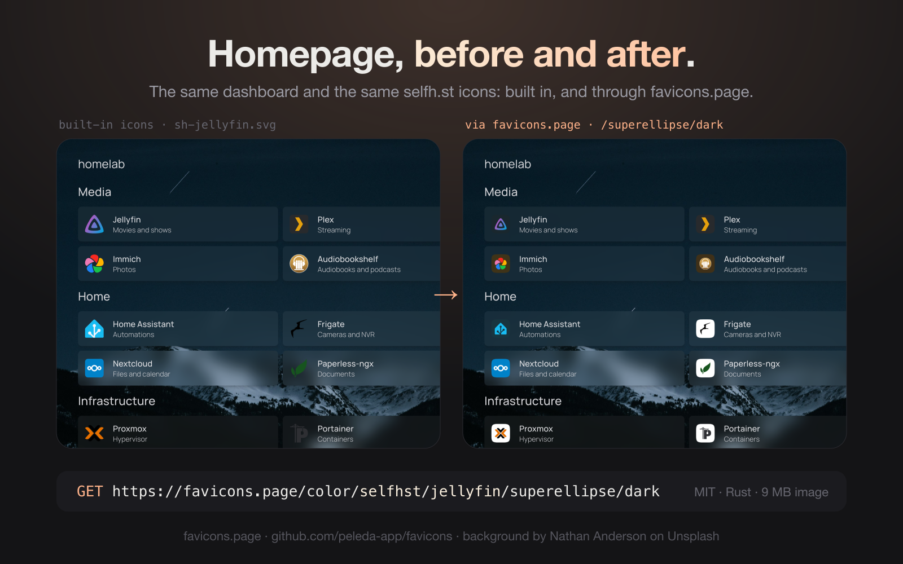
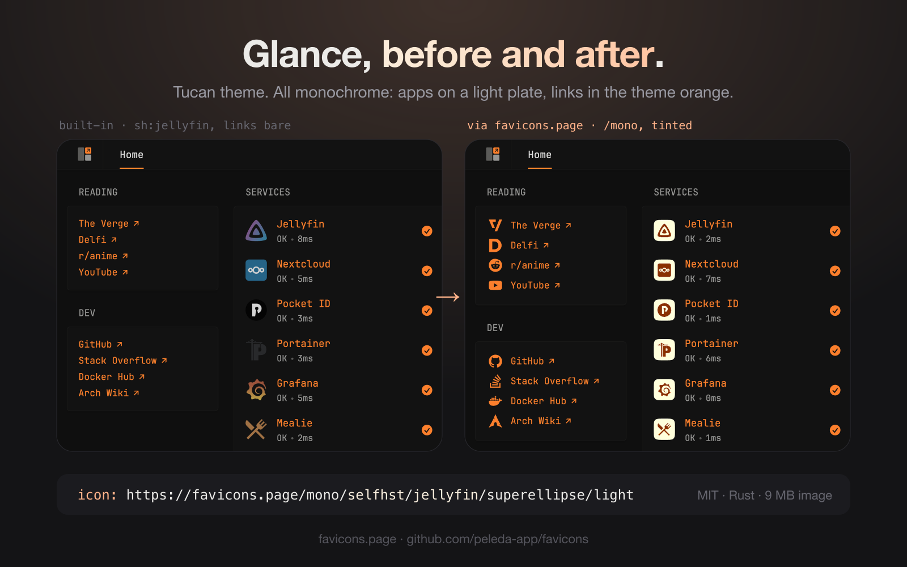

<div align="center">


**Any website's icon as a clean, safe SVG, with colours that fit every theme.**

[](https://github.com/peleda-app/favicons/actions/workflows/ci.yml)
[](https://github.com/peleda-app/favicons/pkgs/container/favicons)
[](https://hub.docker.com/r/favicons/favicons)
[](LICENSE)

[**Try it on favicons.page**](https://favicons.page) · [API](docs/API.md) · [Self-hosting](docs/SELF-HOSTING.md) · [Security](docs/SECURITY.md)

</div>

## One URL per site

```html

```

No key, no query parameters, CORS open. Every response is an edge-to-edge SVG,
and its headers carry the colours to put around it:

```
x-icon-shape: square            x-icon-light-plate: #ebecfa
x-icon-fill: bleed              x-icon-dark-plate:  #181b3f
x-icon-accent: #5a67f2          x-icon-dark-text:   #6b77f3
```

Or let the server draw the badge for you, on a rounded square or an iOS-style
superellipse. It follows the viewer's light or dark theme by itself; add
`/light` or `/dark` to pin one:

```html

```

Need a single-colour icon for a toolbar or a tab bar? Ask for the mask and tint it with CSS:

```css
.icon {
  background: currentColor;
  mask: url(https://favicons.page/mono/discord.com) center / contain no-repeat;
}
```



## Follows your theme



Icons are made to switch with your interface, not to fight it.

- **Automatic light and dark.** Leave the theme out, as in
  `/color/github.com/superellipse`, and the SVG carries both palettes and
  switches them with the viewer's `prefers-color-scheme`. One URL for light and
  dark pages, and it flips the moment the operating system does.
- **Your own theme switch.** If your app has a toggle of its own, pin a version
  with `/light` or `/dark` and swap the URL. Every version has a stable URL and
  its own cache entry, so icons look the same on every visit.
- **Any colour you like.** `/mono/{site}` is a mask: tint it with your accent
  or with the `X-Icon-*-Mono` colour from the headers. `X-Icon-*-Text` and
  `X-Icon-*-Mono-Plate` colour the sender name and the link chip around it.
- **Safe to inline.** Ids and classes inside every SVG are unique to that icon,
  so dozens of them can sit in one page without clashing.

```html
      <!-- follows the OS -->
 <!-- pinned -->
```

## From JavaScript

[`favicons.page`](clients/js) on npm has no dependencies and works in
browsers, Node 18+, Deno, Bun and edge runtimes. It builds URLs, reads the SVG
with its palette, waits out the first `queued` response for you, and points at
your own instance with one option. Components for React and Vue, a Svelte
action and a web component come in the same package:

```bash
npm install favicons.page
```

```js
import { iconUrl, getIcon } from "favicons.page";

iconUrl("github.com", { shape: "superellipse" });
// https://favicons.page/color/github.com/superellipse

const icon = await getIcon("discord.com");
icon.palette.dark.plate; // "#181b3f"
```

```jsx
import { Favicon } from "favicons.page/react";

<Favicon domain="github.com" shape="superellipse" size={40} alt="GitHub" />
<Favicon domain="github.com" mono size="1em" />  {/* a mask in the text colour */}
```

## Why favicons

- **Vector, always.** Sites that ship SVG keep their exact shapes. Bitmaps are
  traced into smooth vectors, so even a 32 px `favicon.ico` scales to any size.
- **Looks right on light and dark.** Badge, text and mask colours for both
  themes, checked against WCAG contrast. No more black logo on a black row.
- **The real logo first.** The owner's BIMI mail logo, then the site's own icons
  and manifests, then optional fallback providers. A generated identicon only
  when nothing exists, and the headers say why.
- **Built to be attacked.** Every image is decoded in a throw-away seccomp
  sandbox with no files, network or exec, then rebuilt by an allowlist SVG
  writer. No SSRF, no decompression bombs, no scripts in your icons.
- **Private by design.** Requests collapse to the registrable domain, so
  per-recipient subdomains can't become read receipts. Lookups go over
  encrypted, malware-filtering DNS. Client IPs are never logged. For stricter
  needs, `private.favicons.page` answers from the cache only and never contacts
  the site.
- **Fast and small.** About 170 000 cached icons per second on a laptop,
  10 000 on a 4-core Celeron thin client, in about 50 MB of RAM.
  [Benchmarks](docs/PERFORMANCE.md).

### Compared with the usual favicon URLs

| | favicons.page | Google `s2/favicons` | DuckDuckGo `ip3` |
|---|---|---|---|
| Format | SVG, any size | PNG, up to 256 px | ICO |
| Colours for light and dark themes | yes, in headers and ready-made badges | no | no |
| Monochrome mask | yes | no | no |
| Icons by app name | about 17 000 | no | no |
| Self-hostable, open source | yes, MIT | no | no |
| Unknown site | unique identicon, `X-Icon-Fallback-Reason` says why | `404` and a generic globe | `404` and a generic image |

## Self-hosted apps by name

Optional catalogs serve icons by slug, with the same palettes, masks and plates.
favicons.page carries about 17 000 of them: [Simple Icons](https://simpleicons.org),
[selfh.st](https://selfh.st/icons/), [Dashboard Icons](https://github.com/homarr-labs/dashboard-icons),
[Devicon](https://devicon.dev) and [theSVG](https://github.com/GLINCKER/thesvg), each
response naming its license:

```html


```



## On your dashboard

Any dashboard that takes an icon URL works:
[Homepage](https://gethomepage.dev) with ready-made badges,
[Glance](https://github.com/glanceapp/glance) with monochrome masks tinted to its theme.





## Self-host in one command

```bash
curl -O https://raw.githubusercontent.com/peleda-app/favicons/main/docker-compose.yml
docker compose up -d
```

Two containers from a 9 MB image (on GHCR and as `favicons/favicons` on Docker Hub): the API, and a renderer with no network, a
read-only root and no capabilities. This page itself is built with the
`site` feature and ships with prerendered catalogs and the icons of the 100 000
most popular sites as `ghcr.io/peleda-app/favicons.page`; release binaries are on [GitHub Releases](https://github.com/peleda-app/favicons/releases),
and `cargo install favicons` builds the API. Built-in Let's Encrypt, local
disk or S3, GCS and Azure caches, blocklists and every other option are in
[docs/SELF-HOSTING.md](docs/SELF-HOSTING.md).

## For agents and automations

[`/llms.txt`](https://favicons.page/llms.txt) explains the API to language
models, [`/openapi.json`](https://favicons.page/openapi.json) describes it for
tools, and every response exposes its headers and timings to any origin.

## Documentation

- [How it works](docs/FEATURES.md): sources, tracing, caching, the request path
- [HTTP API](docs/API.md): statuses, headers, palettes, fallback reasons
- [Security model](docs/SECURITY.md): threats, sandbox, hardening checklist
- [Self-hosting](docs/SELF-HOSTING.md): Docker, binaries, TLS, small servers
- [Performance](docs/PERFORMANCE.md): wrk numbers and the k6 load test suite
- [JavaScript](clients/js): the `favicons.page` npm package with React, Vue, Svelte and web components

```bash
cargo fmt --check && cargo clippy --all-targets -- -D warnings && cargo test
```

[MIT](LICENSE). The banner shows logos of open-source self-hosted projects, each a trademark of its project ([list](docs/brand/LOGOS.md)); page icons by [Phosphor](https://phosphoricons.com) ([MIT](docs/brand/LICENSE-phosphor-icons)) and [Fluent Emoji](https://github.com/microsoft/fluentui-emoji) ([MIT](docs/brand/LICENSE-fluent-emoji)).
