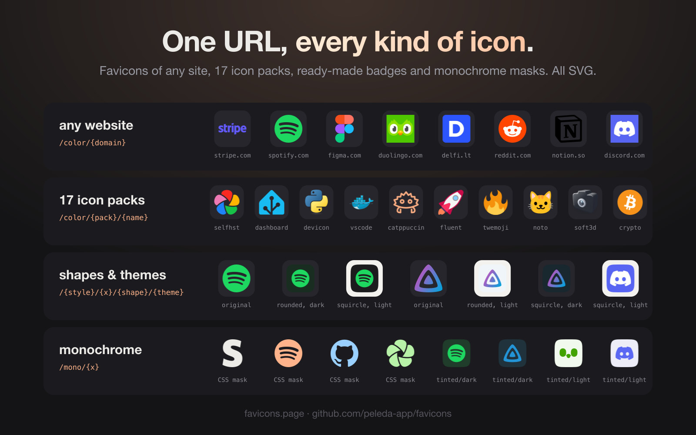

# favicons.page

Any website's icon as a clean, safe SVG, with colours that fit every theme. A zero-dependency client with React and Vue components, a Svelte action and a web component.

[Try it live](https://favicons.page) · [Documentation](https://favicons.page/docs/clients/javascript) · [HTTP API](https://favicons.page/docs/api/overview) · [GitHub](https://github.com/peleda-app/favicons)



## Install

```bash
npm install favicons.page
```

Works in browsers, Node 18+, Deno, Bun and edge runtimes. React and Vue are optional peer dependencies; nothing else is installed.

| Import | What |
| ------ | ---- |
| `favicons.page` | URLs, the SVG with its palette, catalogs |
| `favicons.page/react` | `<Favicon>`, `<FaviconsProvider>`, `useFavicon`, `useFaviconUrl` |
| `favicons.page/vue` | `<Favicon>`, `FaviconsPlugin`, `useFavicon`, `useFaviconUrl` |
| `favicons.page/svelte` | the `use:favicon` action |
| `favicons.page/element` | the `<favicon-icon>` web component |

## Usage

```js
import { iconUrl, getIcon } from 'favicons.page'

iconUrl('github.com') // https://favicons.page/color/github.com
iconUrl('github.com', { shape: 'superellipse' }) // a badge that follows the viewer's theme

const { svg, palette } = await getIcon('discord.com')
palette.dark.plate // "#181b3f"
```

```jsx
import { Favicon } from 'favicons.page/react'

<Favicon domain="github.com" shape="superellipse" size={40} alt="GitHub" />
<Favicon domain="github.com" mono size="1em" />
```

```html
<script type="module">
  import { defineFaviconElement } from 'https://cdn.jsdelivr.net/npm/favicons.page@0/element.js'
  defineFaviconElement()
</script>
<favicon-icon domain="github.com" shape="superellipse" size="40"></favicon-icon>
```

Point everything at your own server with `createFavicons({ baseUrl: 'https://icons.example.com' })`, or read the cache only with `createFavicons({ private: true })`.

## Documentation

- [JavaScript client](https://favicons.page/docs/clients/javascript): URLs, palettes, masks, catalogs, private mode, server-side rendering, reference
- [React](https://favicons.page/docs/clients/react) and Next.js
- [Vue](https://favicons.page/docs/clients/vue) and Nuxt
- [Svelte](https://favicons.page/docs/clients/svelte) and SvelteKit
- [Web component](https://favicons.page/docs/clients/web-component)
- [Your own badge](https://favicons.page/docs/guide/badges#your-own-badge)
- [Self-hosting](https://favicons.page/docs/self-hosting/install)

## License

[MIT](https://github.com/peleda-app/favicons/blob/main/LICENSE). Logos stay trademarks of their owners: show them to identify the site, not to imply endorsement.
