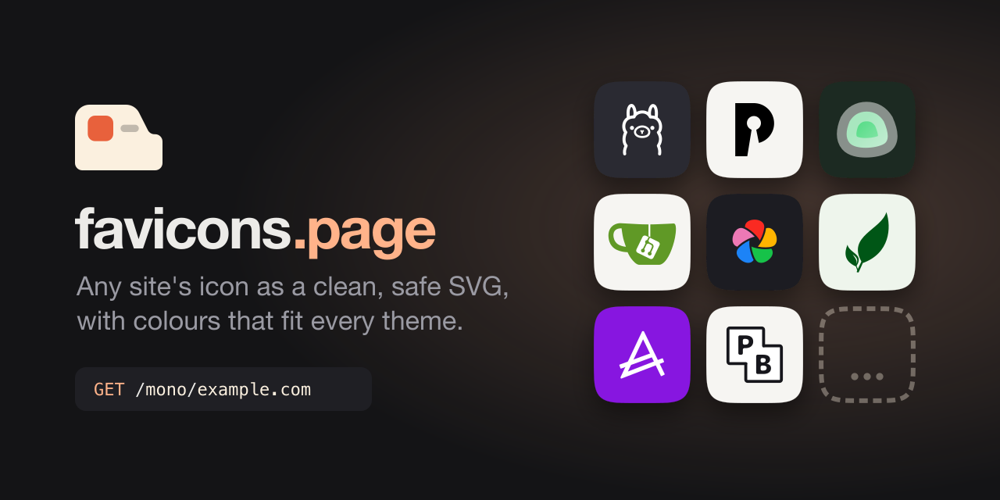
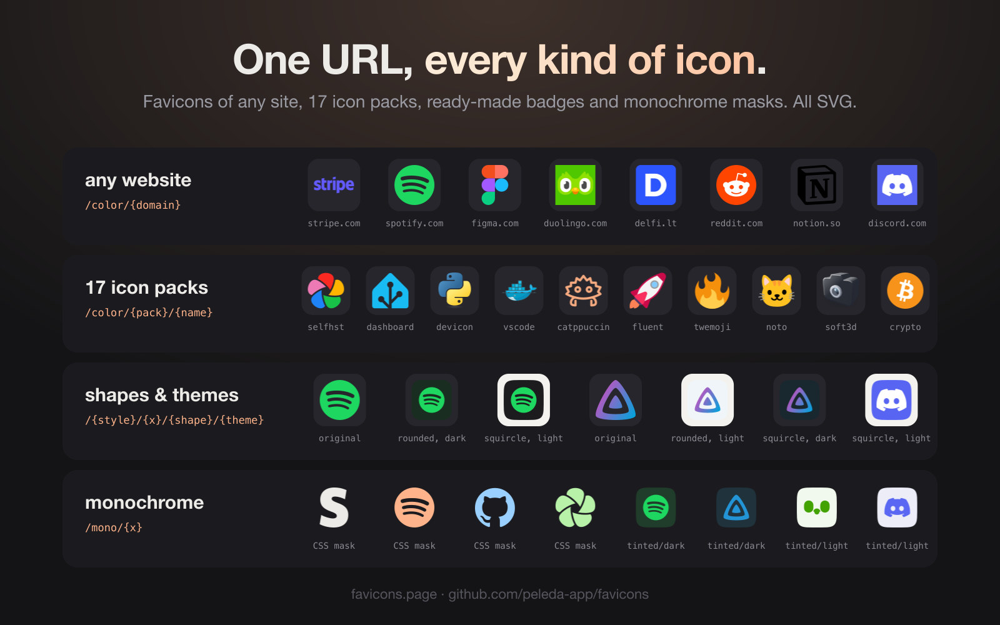

[](https://favicons.page)

# favicons

**Any website's icon as a clean, safe SVG, with colours that fit every theme.** Self-hosted, in a 9 MB image.

[](https://github.com/peleda-app/favicons/releases)
[](https://hub.docker.com/r/favicons/favicons/tags)

[](https://github.com/peleda-app/favicons/blob/main/LICENSE)
[](https://github.com/peleda-app/favicons)

[**Try it live**](https://favicons.page) · [HTTP API](https://github.com/peleda-app/favicons/blob/main/docs/API.md) · [Self-hosting guide](https://github.com/peleda-app/favicons/blob/main/docs/SELF-HOSTING.md) · [Security](https://github.com/peleda-app/favicons/blob/main/docs/SECURITY.md) · [GitHub](https://github.com/peleda-app/favicons)

`GET /color/github.com` returns the site's icon as a 128×128 SVG, plus the badge, text and mask colours for light and dark themes in its headers. The service you see at [favicons.page](https://favicons.page) is this image with the demo page built in.

## Why

- **Vector, always.** Sites that ship SVG keep their exact shapes; bitmaps are traced, so even a 16 px `favicon.ico` scales to any size.
- **Looks right on light and dark.** Badge, text and mask colours for both themes, checked against WCAG contrast, and ready-made badges at `/color/{domain}/rounded` or `/superellipse`.
- **Built to be attacked.** Every image is decoded in a throw-away seccomp sandbox with no files, network or exec, then rebuilt by an allowlist SVG writer. No SSRF, no decompression bombs, no scripts.
- **Private.** Requests collapse to the registrable domain, lookups go over encrypted, malware-filtering DNS, client IPs are never logged.
- **Small and fast.** One static binary in a `scratch` image, about 12 MB of RAM idle, 10 000 cached icons per second on a 4-core Celeron.

## Quick start

```bash
docker run -d --name favicons -p 8080:8080 \
  --read-only --cap-drop ALL --security-opt no-new-privileges \
  -v favicons-cache:/var/cache/favicons \
  -e FAVICONS_CACHE__STORAGE=/var/cache/favicons \
  favicons/favicons
```

```bash
curl -sI http://localhost:8080/color/github.com
```

```html

```

## Hardened setup with Docker Compose

The API fetches and caches; a separate renderer decodes untrusted images with **no network**, a read-only root and no capabilities.

```bash
curl -O https://raw.githubusercontent.com/peleda-app/favicons/main/docker-compose.yml
docker compose up -d
```

Check the sandbox on your kernel; it must exit with 159:

```bash
docker run --rm favicons/favicons sandbox-selftest net
```

## Configuration

Every option of [config.example.toml](https://github.com/peleda-app/favicons/blob/main/config.example.toml) is also an environment variable: `FAVICONS_<SECTION>__<KEY>`.

| Variable | What |
|----------|------|
| `FAVICONS_CACHE__STORAGE` | `none` (memory), a directory, or `s3://`, `gs://`, `az://` |
| `FAVICONS_TLS__ENABLED`, `FAVICONS_TLS__DOMAINS` | Built-in HTTPS with Let's Encrypt |
| `FAVICONS_POLICY__BLOCKLISTS` | Hosts, adblock or plain-domain lists to refuse |
| `FAVICONS_SERVER__PRIVATE_HOSTS` | Hosts that answer from the cache only and never contact a site |
| `FAVICONS_CONFIG` | Path to a TOML file instead |
| `FAVICONS_LOG`, `FAVICONS_LOG_FORMAT=json` | Log filter and JSON logs |

## Tags

| Tag | Follows |
|-----|---------|
| `latest`, `main` | The main branch |
| `1.3`, `1.3.0` | Releases |
| `sha-<commit>` | One exact build |

Multi-arch (`linux/amd64`, `linux/arm64`), running as uid 65534. Every image carries a signed build provenance attestation; the same images are on `ghcr.io/peleda-app/favicons`.

## From JavaScript

```bash
npm i favicons.page
```

A zero-dependency client with React and Vue components, a Svelte action and a web component; point it at your instance with `createFavicons({ baseUrl: "https://icons.example.com" })`. See [favicons.page on npm](https://www.npmjs.com/package/favicons.page).

[](https://favicons.page)

MIT licensed. Icon catalogs keep their own licenses.
