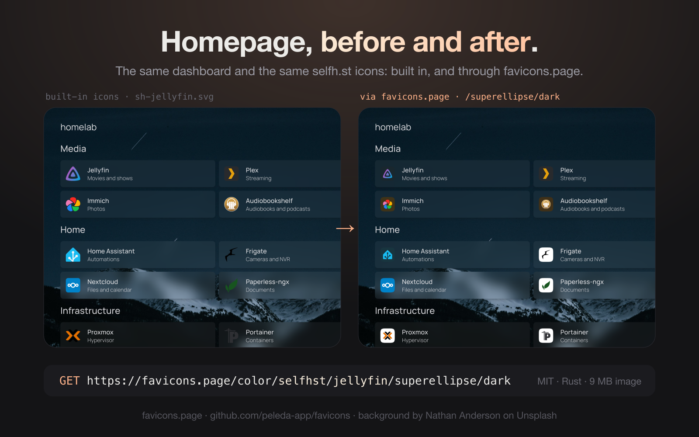

# Catalogs

Optional catalogs serve icons by slug instead of by domain, with the same palettes, masks and badges. favicons.page carries about 17 000 of them, each response naming its license:

```html


```

| Catalog | License |
| ------- | ------- |
| [selfh.st icons](https://selfh.st/icons/) | CC BY 4.0 |
| [Simple Icons](https://simpleicons.org) | CC0 |
| [Dashboard Icons](https://github.com/homarr-labs/dashboard-icons) | Apache-2.0 |
| [Devicon](https://devicon.dev) | MIT |
| [theSVG](https://github.com/GLINCKER/thesvg) | per icon |
| [Iconify](https://github.com/iconify/icon-sets) sets such as Fluent Emoji | per set |

`/catalogs.json` lists the configured catalogs and `/catalogs/{id}.json` their slugs. The route, statuses and index formats are in [Catalog API](../api/catalogs.md); adding catalogs to your own server is in [Configuration](../self-hosting/configuration.md#catalogs).

## Dashboards

Any dashboard that takes an icon URL works: [Homepage](https://gethomepage.dev) with ready-made badges, [Glance](https://github.com/glanceapp/glance) with monochrome masks tinted to its theme.



Logos stay trademarks of their owners whatever the file's license; show them to identify the brand, not to imply endorsement.
